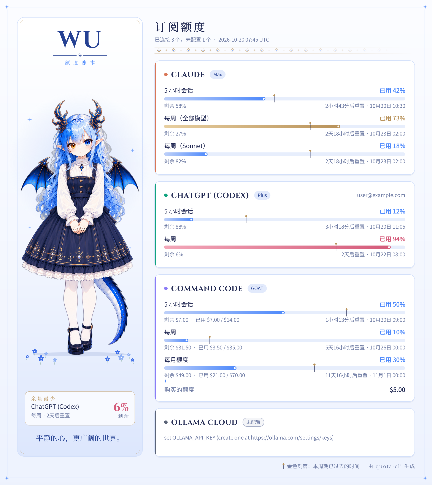

# quota-cli

一个命令行工具，汇总各家 AI 订阅的用量和剩余额度：**Claude**、**ChatGPT（Codex）**、**Command Code**、**Ollama Cloud**、**OpenCode Go**。

- 单个可执行文件，支持 Ubuntu / Windows（也能编译 macOS）。
- `--json` 输出固定结构的 JSON，方便 agent 和脚本读取。
- `--png` 生成一张带详细数据的仪表盘图片。
- 直接复用本机已有的登录状态，不保存、不上传任何凭据，也不会刷新或改写各工具的 token。



## 安装

从 Releases 下载对应平台的二进制，或者自己编译：

```bash
go install github.com/wuhanhao456/quota-cli/cmd/quota@latest
```

## 用法

```bash
quota                         # 终端表格
quota --json                  # JSON，给 agent 用
quota --png quota.png         # 同时生成图片
quota --json --png quota.png  # JSON 输出到 stdout，同时生成图片
quota --providers claude,chatgpt
quota --from-json saved.json --png quota.png   # 用保存的 JSON 重新出图
```

### 图片风格

图片按角色 Wu 的设定图配色（瓷白、天蓝、钴蓝、深蓝，点缀龙角的古金色），左侧是她的立绘，默认内嵌在程序里。可以换成别的角色或关掉：

```bash
quota --png quota.png --avatar ./me.png --persona-name "LUNA" --persona-tagline "Stay curious."
quota --png quota.png --avatar none    # 不要立绘，只保留数据卡片
```

也可以用环境变量 `QUOTA_AVATAR`、`QUOTA_PERSONA_NAME`、`QUOTA_PERSONA_TAGLINE` 设默认值（方便 Hermes 这类 agent 调用时不用带参数）。立绘建议用透明背景的 PNG。图里的字体是 Cinzel 和 Cormorant Garamond（SIL OFL 1.1，见 `internal/render/assets`）。

退出码：只要有一家取数成功就是 0；所有已配置的服务都失败时是 1；参数错误是 2。

## 给 Hermes Agent 用

仓库里带了一个 [Hermes](https://github.com/NousResearch/hermes-agent) skill：[skills/quota-usage](skills/quota-usage/SKILL.md)。装好之后，问 Hermes「Claude 额度还剩多少」「发我一张用量图」，它会自动调用 `quota --json`，需要时用 `--png` 出图并直接发到聊天里。

```bash
# 在运行 Hermes 的机器上
hermes skills install wuhanhao456/quota-cli/skills/quota-usage
curl -fsSL https://raw.githubusercontent.com/wuhanhao456/quota-cli/main/skills/quota-usage/scripts/install.sh | bash   # 安装 quota 到 ~/.local/bin
```

各服务的登录方法见 [skills/quota-usage/references/setup.md](skills/quota-usage/references/setup.md)。注意凭据要在 Hermes 所在的机器上，以运行 Hermes 的那个用户身份登录。

## 各服务的数据来源

| 服务 | 凭据来源 | 接口 | 能拿到的数据 |
| --- | --- | --- | --- |
| Claude | Claude Code 登录文件 `~/.claude/.credentials.json`（或 `$CLAUDE_CONFIG_DIR`），也可设 `CLAUDE_OAUTH_TOKEN` | `GET api.anthropic.com/api/oauth/usage` | 5 小时会话、每周（全部 / Opus / Sonnet）用量百分比和重置时间；开启了额外用量时显示月度美元额度 |
| ChatGPT | Codex CLI 登录文件 `~/.codex/auth.json`（或 `$CODEX_HOME`） | `GET chatgpt.com/backend-api/wham/usage` | Codex 的 5 小时和每周额度、套餐、额外 credits |
| Command Code | `cmd login` 保存的 `~/.commandcode/auth.json`，或 `COMMANDCODE_API_KEY` | `GET api.commandcode.ai/alpha/billing/credits`、`/subscriptions` | 5 小时、每周、月度美元额度，剩余额度，购买的 credits，套餐 |
| Ollama Cloud | 环境变量 `OLLAMA_API_KEY`（在 https://ollama.com/settings/keys 生成）；旧版套餐另需浏览器 cookie：`OLLAMA_COOKIE` 或文件 `~/.config/quota-cli/ollama-cookie` | `GET ollama.com/api/balance`；有 cookie 时读 `ollama.com/settings` 页面 | 新套餐：当月包含额度的已用 / 剩余，购买的余额，重置时间。旧套餐：会话（或每小时）和每周用量百分比及重置时间 |
| OpenCode Go | opencode 的登录（`opencode auth login` 选 OpenCode Go，存在 `~/.local/share/opencode/opencode.db`，旧版是同目录的 `auth.json`），或环境变量 `OPENCODE_API_KEY` | `GET opencode.ai/zen/go/v1/usage` | 5 小时、每周、每月额度的用量百分比和重置时间 |

说明：

- 这些接口大多没有公开文档（取数方式参考了 [CodexBar](https://github.com/steipete/CodexBar)），服务方改接口后可能需要更新。
- ChatGPT 网页版的聊天次数限制没有接口可查，这里显示的是 Codex 额度。
- Ollama 旧版套餐按会话 / 每周百分比计量，API key 拿不到，只能用登录 cookie 读设置页（取法见 [setup.md](skills/quota-usage/references/setup.md#ollama-cloud)）。cookie 只在本机读取，不会写进仓库或输出。两者都配时，百分比来自页面，购买余额来自 API。
- macOS 上 Claude Code 把 token 存在钥匙串里，需要自己设置 `CLAUDE_OAUTH_TOKEN`。
- token 过期时工具会提示你运行一次对应的 CLI（`claude` / `codex`）来刷新，不会自己刷新，避免把那些工具的登录弄失效。

## JSON 结构

```jsonc
{
  "schema_version": 1,
  "generated_at": "2026-10-20T07:45:00Z",
  "providers": [
    {
      "provider": "claude",            // claude | chatgpt | commandcode | ollama | opencode
      "name": "Claude",
      "status": "ok",                  // ok | unconfigured | error
      "plan": "Max",
      "account": "",                   // 有的服务会返回邮箱
      "source": "oauth",
      "windows": [
        {
          "id": "session",             // session | hourly | weekly | weekly_opus | monthly | extra_usage ...
          "label": "Session (5h)",
          "used_percent": 42,
          "used": 7, "limit": 14, "remaining": 7,   // 仅在有金额时出现
          "unit": "percent",           // percent | usd
          "resets_at": "2026-10-20T10:30:00Z"
        }
      ],
      "details": [{ "label": "Purchased credits", "value": "$5.00" }],
      "error": "",                     // status 不是 ok 时说明原因
      "fetched_at": "2026-10-20T07:45:00Z"
    }
  ]
}
```

完整示例见 [examples/sample.json](examples/sample.json)。
